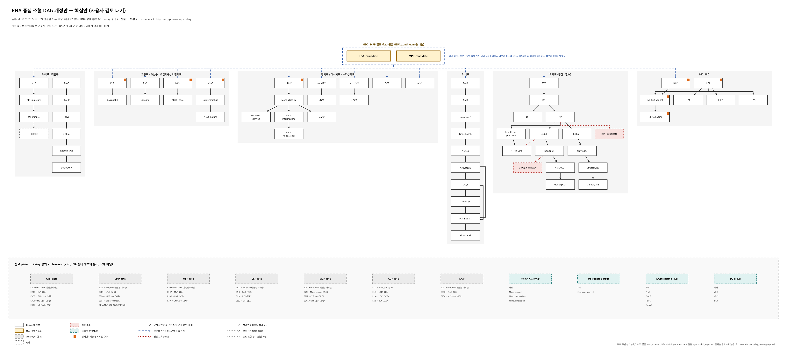

# RNA 중심 조혈 DAG — 사용자 검토용 branch

기존 문헌 DAG를 RNA 상태 후보와 실험적 분류/기능 근거로 나누고 HSC·MPP를 별도 후보로 표시하는 개정안이다.

- [구현 계획](docs/IMPLEMENTATION_RNA_DAG_REVIEW_2026-10-16.md)
- [그림·표 설명과 재현 방법](docs/rna_dag_review/README_ko.md)
- 상태(2026-10-18 직접 검증): R 빌더·렌더러, 원본 대응표, PNG 8장·PDF 8장 구현. 사용자 검토 대기.
- 검증: R 4.5.2, igraph 2.2.3, digest 0.6.39, testthat 3.3.2에서 `Rscript tests/R/rna_dag_review/run_tests.R` 실행. 26개 테스트 묶음·6,452개 확인 항목, 실패·오류·건너뜀·경고 모두 0건.
- 원본 76개 노드·89개 연결을 모두 추적한다. HSC·MPP는 별도 후보이며 기존 HSPC 출발 연결 19개의 출발점은 미해결로 남겼다.
- RNA 구별 가능성은 아직 검증하지 않았다. 새 항목의 승인 상태는 모두 `pending`이다. PNG 개요를 직접 확인했으며 PDF 페이지와 macOS 이외 렌더링은 직접 열어 확인하지 않았다.
- **사용자 승인 전 main/Route 병합 및 운영 모델 채택 금지.**
- 별도 분기 비교 기능은 `codex/branch-candidates-2026-10-16` branch에서 개발한다.

[원본과 개정안 비교 그림](docs/rna_dag_review/figures/rna_dag_original_vs_proposed.png) · [계통별 상세 그림](docs/rna_dag_review/figures/) · [사용자 확인 항목](docs/rna_dag_review/approval_checklist.tsv)

검토할 내용은 개정안 전체 구성, HSC·MPP 출발점 미해결 유지 여부, assay 정의·산물·상위 분류의 참고 항목 분리 여부다. 고칠 노드·연결 ID와 내용을 지정할 수 있다.
